<!--
  Profile README for @htthinh1999.
  • Header + tech stack images: edit scripts/profile-metrics/config.json, then `npm run assets`.
  • Activity cards: rebuilt daily by .github/workflows/profile-metrics.yml and served from the `metrics` branch.
-->

<a href="https://info.keycodemon.org/">
  <picture>
    <source media="(prefers-color-scheme: dark)" srcset="https://raw.githubusercontent.com/htthinh1999/htthinh1999/main/assets/header-dark.svg">
    <source media="(prefers-color-scheme: light)" srcset="https://raw.githubusercontent.com/htthinh1999/htthinh1999/main/assets/header-light.svg">
    
  </picture>
</a>

## About me

I'm a software engineer from **Nha Trang, Việt Nam**. I build backend services with **C# and .NET**, ship cross-platform apps with **Flutter**, and look after the platform they run on — containers on **Kubernetes**, infrastructure as code with **Terraform**, and **GitOps** delivery.

- **Building** — APIs and services on ASP.NET Core, backed by SQL Server and MySQL
- **Operating** — Kubernetes workloads packaged with Helm and exposed through Cloudflare Tunnel
- **Automating** — CI/CD pipelines with GitHub Actions, Argo CD and Jenkins
- **Elsewhere** — [info.keycodemon.org](https://info.keycodemon.org/)

## Tech stack

<picture>
  <source media="(prefers-color-scheme: dark)" srcset="https://raw.githubusercontent.com/htthinh1999/htthinh1999/main/assets/stack-dark.svg">
  <source media="(prefers-color-scheme: light)" srcset="https://raw.githubusercontent.com/htthinh1999/htthinh1999/main/assets/stack-light.svg">
  
</picture>

## Activity

  <picture>
    <source media="(prefers-color-scheme: dark)" srcset="https://raw.githubusercontent.com/htthinh1999/htthinh1999/metrics/overview-dark.svg">
    <source media="(prefers-color-scheme: light)" srcset="https://raw.githubusercontent.com/htthinh1999/htthinh1999/metrics/overview-light.svg">
    
  </picture>
  <picture>
    <source media="(prefers-color-scheme: dark)" srcset="https://raw.githubusercontent.com/htthinh1999/htthinh1999/metrics/languages-dark.svg">
    <source media="(prefers-color-scheme: light)" srcset="https://raw.githubusercontent.com/htthinh1999/htthinh1999/metrics/languages-light.svg">
    
  </picture>

<picture>
  <source media="(prefers-color-scheme: dark)" srcset="https://raw.githubusercontent.com/htthinh1999/htthinh1999/metrics/rhythm-dark.svg">
  <source media="(prefers-color-scheme: light)" srcset="https://raw.githubusercontent.com/htthinh1999/htthinh1999/metrics/rhythm-light.svg">
  
</picture>

## Selected open source

| Project | What it is | Built with |
| --- | --- | --- |
| [**cloudflared**](https://github.com/htthinh1999/cloudflared) | Helm chart for running a Cloudflare Tunnel on Kubernetes | Helm · Kubernetes |
| [**reusable-workflow**](https://github.com/htthinh1999/reusable-workflow) | Reusable GitHub Actions CI workflow for Google Cloud Run | GitHub Actions · Cloud Run |
| [**HeThongQuanLyCongTacKhaoThi**](https://github.com/htthinh1999/HeThongQuanLyCongTacKhaoThi) | Exam administration management system | ASP.NET Core · C# |
| [**QuanLyQuanCafe**](https://github.com/htthinh1999/QuanLyQuanCafe) | Café management desktop software | C# · DevExpress · SQL Server |
| [**NhanDienBienSoXe**](https://github.com/htthinh1999/NhanDienBienSoXe) | Vehicle licence-plate recognition from images | C# · image processing |
| [**Practice_Olympic_Informatics**](https://github.com/htthinh1999/Practice_Olympic_Informatics) | Solutions to Informatics Olympiad practice problems | C++ · algorithms |

Activity cards are generated daily from the GitHub API by a [self-hosted workflow](https://github.com/htthinh1999/htthinh1999/blob/main/.github/workflows/profile-metrics.yml) — no WakaTime, no third-party stats services.
